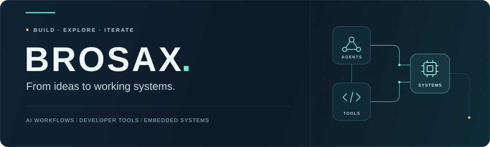

  <picture>
    <source media="(max-width: 600px)" srcset="./assets/header-mobile.svg">
    
  </picture>

  <strong>把想法做成可用的系统。</strong> 
  Building practical tools for AI workflows, code analysis, and the physical world.

  <a href="#user-content-selected-projects">精选项目</a> &nbsp; / &nbsp;
  <a href="https://seei-comunidad.vercel.app">OpenSEEI 在线课程 ↗</a> &nbsp; / &nbsp;
  <a href="https://github.com/Brosax?tab=repositories">全部仓库 ↗</a>

  <code>Python</code> &nbsp; <code>TypeScript</code> &nbsp; <code>React</code> &nbsp; <code>Verilog</code>

 
<h2>Selected projects  / 精选项目</h2>

<table>
  <tr>
    <td width="50%" valign="top">
      01 &nbsp; / &nbsp; DEVELOPER TOOLS
      <h3><a href="https://github.com/Brosax/code-analyzer">code-analyzer</a></h3>
      
C/C++ 静态分析工具链，保留原始发现与证据，生成可离线查看的审查报告。

      
<code>Python</code> <code>Static Analysis</code>

    </td>
    <td width="50%" valign="top">
      02 &nbsp; / &nbsp; AI WORKFLOWS
      <h3><a href="https://github.com/Brosax/Agent_Workflow_Studio">Agent Workflow Studio</a></h3>
      
代码审查 Agent 工作流的本地演示，将流程画布、运行记录、产物与人工审批连接起来。

      
<code>TypeScript</code> <code>React</code>

    </td>
  </tr>
  <tr>
    <td width="50%" valign="top">
      03 &nbsp; / &nbsp; DESKTOP UTILITY
      <h3><a href="https://github.com/Brosax/AI-head-up-dispaly">AI Head-up Display</a></h3>
      
常驻 Windows 托盘，在一个面板查看 AI 订阅余量与 API 余额。

      
<code>Windows</code> <code>AI Usage</code>

    </td>
    <td width="50%" valign="top">
      04 &nbsp; / &nbsp; HARDWARE &amp; IMAGING
      <h3><a href="https://github.com/Brosax/LaserPlatform">LaserPlatform</a></h3>
      
从激光芯片扫描到图像拼接，再通过全景图定位与控制物理位移台。

      
<code>Python</code> <code>PySide6</code>

    </td>
  </tr>
  <tr>
    <td width="50%" valign="top">
      05 &nbsp; / &nbsp; INTERACTIVE LEARNING
      <h3><a href="https://github.com/Brosax/openseei">OpenSEEI</a></h3>
      
电子与智能系统的社区学习笔记，用动画、要点与自测讲清楚背后的机制。

      
<code>Electronics</code> <a href="https://seei-comunidad.vercel.app">在线体验 →</a>

    </td>
    <td width="50%" valign="top">
      06 &nbsp; / &nbsp; EMBEDDED SYSTEMS
      <h3><a href="https://github.com/Brosax/simple_riscv_cpu">Simple RISC-V CPU</a></h3>
      
基于 Verilog 的 RV32I 处理器，配有模块测试、系统集成测试与 ISA 回归测试。

      
<code>Verilog</code> <code>RISC-V</code>

    </td>
  </tr>
</table>

 

  
<strong>AI coding activity</strong> · 查看使用统计

   
  

 

AI workflows &nbsp; · &nbsp; Developer tools &nbsp; · &nbsp; Embedded systems

